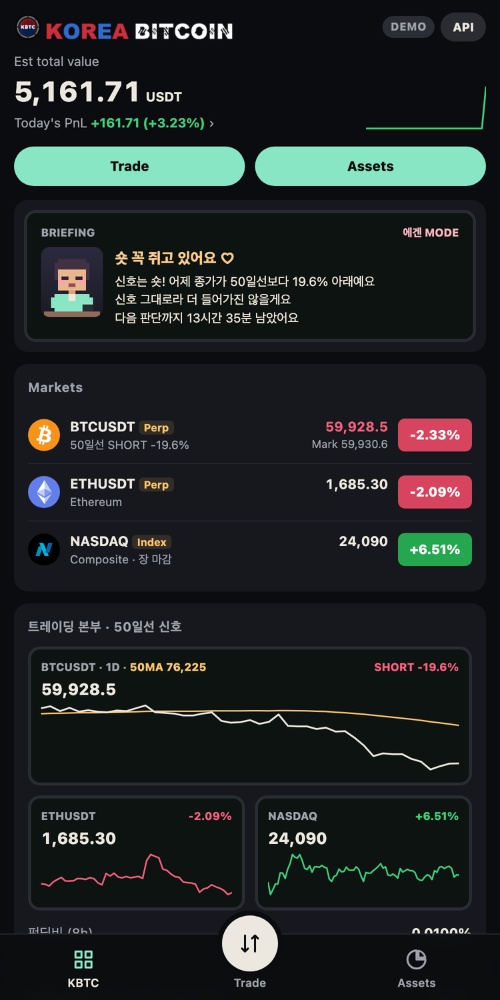
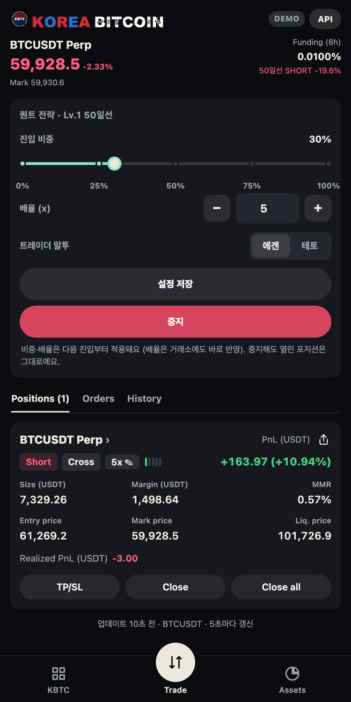
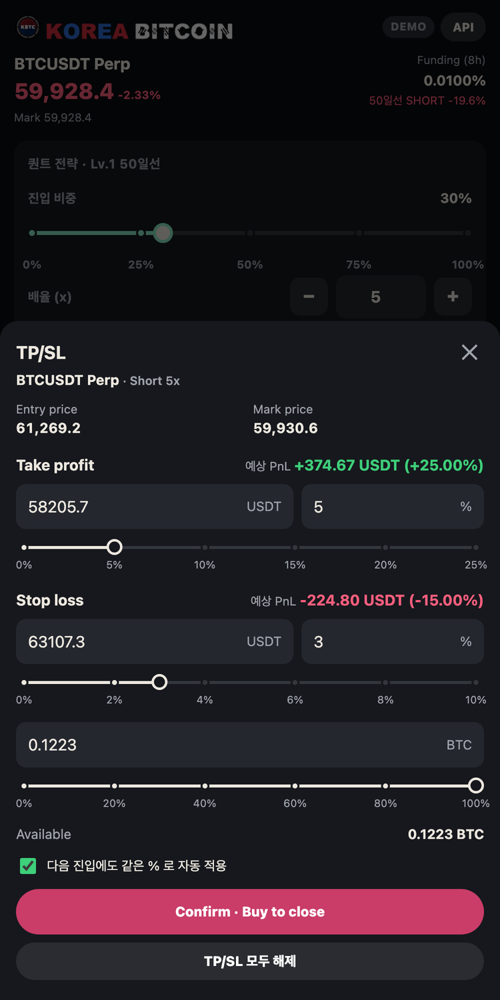
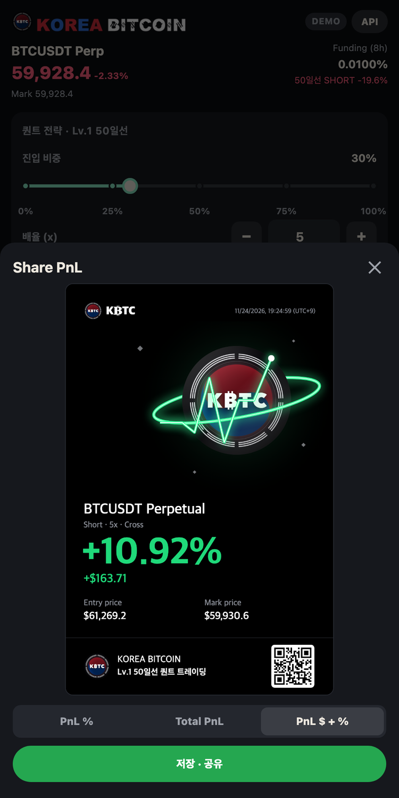
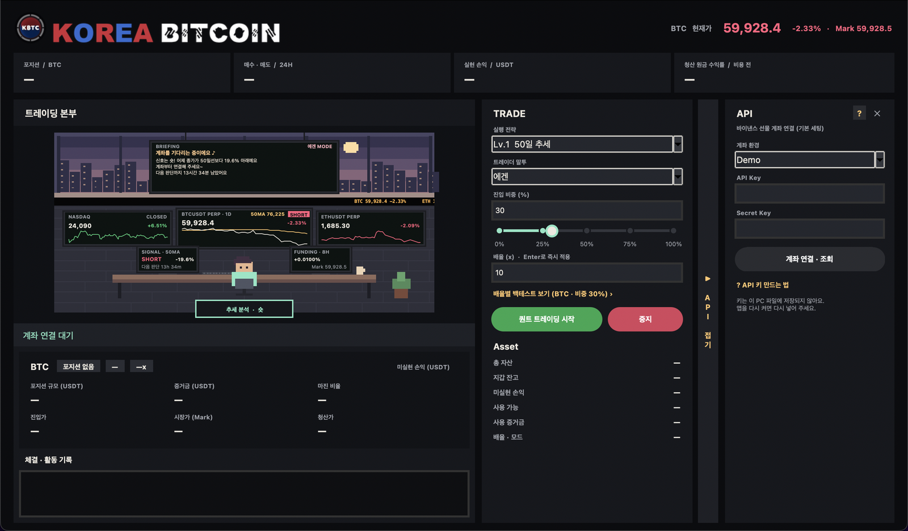
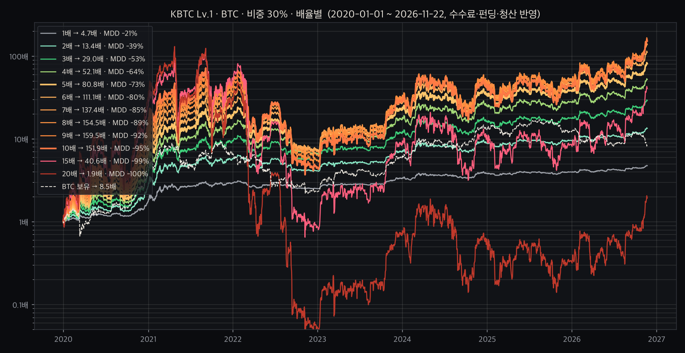

# KBTC · KOREA BITCOIN 퀀트 트레이딩

<p align="center"></p>

<p align="center">
 
 
</p>

BTC 무기한 선물을 **Lv.1 50일선 추세** 전략으로 하루 한 번(09:00 KST 일봉 마감 직후) 자동 매매합니다.
확정 종가가 50일 평균보다 위면 롱, 아래면 숏. 신호가 바뀔 때만 전량 청산 후 반대로 진입합니다.

> ⚠️ 반드시 **바이낸스 Demo(모의) 키로 먼저 테스트**하세요. 백테스트는 과거 결과일 뿐 미래 수익을 보장하지 않으며, 이 코드는 투자 권유가 아닙니다.

## 구성

| 폴더 | 내용 |
|---|---|
| `KBTC_server/` | 24시간 서버: 자동매매 봇 + OKX 스타일 폰 웹앱(KBTC · Trade · Assets) + 텔레그램 봇. 표준 라이브러리만 사용 |
| `KBTC_server/exchanges.py` | OKX · Gate 어댑터 (바이낸스와 같은 메서드·응답 모양) |
| `KBTC_desktop/` | 맥/PC 앱 (Tkinter, 픽셀 트레이딩 본부). `KBTC 실행 (Mac).command` 더블클릭 |
| `백테스트/` | 백테스트 스크립트(pandas, matplotlib) + `결과/` 차트 |
| `로고/` | 로고 이미지와 생성 스크립트(Pillow) |

## 폰 앱 기능

- **바이낸스 Demo · OKX 모의거래 · Gate TestNet** API 키로 각자 접속 (키는 서버에 암호화 저장, OKX 는 Passphrase 도 필요)
- 포지션 카드(OKX식), TP/SL(가격·% · 부분 수량), Close / Close all, PNL 공유 카드
- 계좌 그래프(1D~1Y), Analysis(7D·30D·90D·All, 승률, 손익비, Trading calendar, 펀딩비)
- 배율별 백테스트, 픽셀 트레이더 브리핑(에겐/테토 말투)

## 서버 배포 (Railway 예시)

```bash
cd KBTC_server
railway init && railway up
```

1. 리전은 **Southeast Asia** (미국 리전은 바이낸스가 차단)
2. 변수: `BINANCE_API_KEY`, `BINANCE_API_SECRET`, `MODE=demo`, `WEIGHT=30`, `LEVERAGE=5`(최대 15), `STATE_DIR=/data`, `TZ=Asia/Seoul`
3. 볼륨을 `/data`에 연결하고 `railway domain`으로 주소 발급
4. (선택) 텔레그램: BotFather로 봇 생성 → `TELEGRAM_BOT_TOKEN` → 봇에 `/start` → 알려주는 ID를 `TELEGRAM_CHAT_ID`로 설정

로컬 실행: `config.env.example`을 `config.env`로 복사해 값을 채우고 `python3 main.py`.



## 백테스트 요약 (BTC · 비중 30%, 2020-01 ~ 2026-11, 수수료·펀딩·청산 반영)

| 배율 | 최종(5,000 USDT 시작) | 연평균 | 최대 낙폭 |
|---|---|---|---|
| 3배 | 144,979 | +63.0% | -52.7% |
| 5배 | 404,183 | +89.2% | -72.9% |
| 10배 | 759,729 | +107.3% | -94.9% |
| 20배 | 9,642 | +10.0% | -99.97% |

추천: 비중 30%면 배율 3~5배.



## 바이낸스 Demo API 키 만들기

demo.binance.com 로그인 → 오른쪽 위 사람 아이콘 → Demo Trading API → Create API → System generated → 이름 입력 → API Key·Secret Copy → Enable Futures 확인.
선물 포지션 모드는 단방향(One-way). 키는 절대 다른 사람에게 보내지 마세요.
